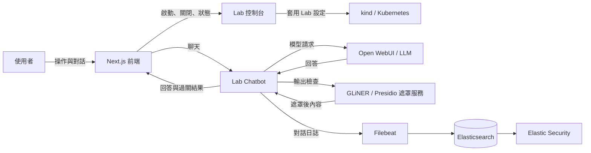

# AI Security Practice Lab

AI 資安實驗平台：使用者在網頁選擇 Lab、啟動實驗環境，並透過聊天室練習攻防。目前提供 [Lab01：Prompt Injection](Lab/Lab01-Prompt%20Injection/README.md)。

## 平台架構



- `frontend/`：Lab 目錄、操作介面與聊天室。
- `portal/`：讀取 Lab 設定，管理 Kubernetes 資源與狀態。
- `chatbot/`：聊天、輸入／輸出護欄與通關判定。
- `output-masker/`：GLiNER 偵測與 Presidio 輸出遮罩。
- `Lab/`：各關的情境、規則與 Kubernetes 資源。

目前控制器支援 `elastic_chatbot` profile；新增不同服務組合需擴充控制器。

## 啟動平台

需求：Docker Desktop、kind、kubectl、Python 3、Node.js，以及可連線的 Open WebUI。

```powershell
python -m pip install -r portal/requirements.txt
npm install --prefix frontend
npm run dev
```

開啟 [http://127.0.0.1:3000](http://127.0.0.1:3000)，選擇 Lab 並啟動。模型與關卡設定請參考各 Lab 的說明。
