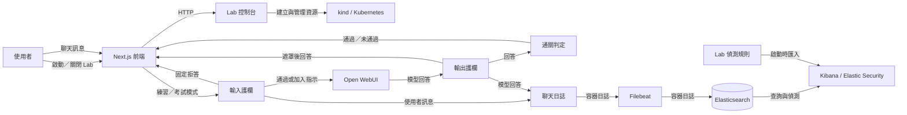

# AI Security Practice Lab

本機 AI 資安實驗平台。透過網頁啟動 Kubernetes Lab，練習 Prompt Injection、調整 LLM 護欄，並在 Elastic Security 查看偵測結果。目前提供 Lab01：取得 chatbot 的 system prompt。

## 資料流程圖（DFD）



輸入護欄、輸出護欄與通關判定由 Lab chatbot 執行；練習模式可在前端調整護欄，考試模式使用關卡預設設定。Lab01 考試模式目前預設關閉護欄。

## 快速開始

需求：Docker Desktop（已啟動）、kind、kubectl、Python 3、Node.js，以及可連線的 Open WebUI 和模型。

1. 安裝依賴：

   ```powershell
   python -m pip install -r portal/requirements.txt
   npm install --prefix frontend
   ```

2. 在 `Lab/Lab01-Prompt Injection/50-chatbot.yaml` 設定 Open WebUI 的 `BASEURL`（不含 `/v1`）與 `OPENWEBUI_MODEL`。建立 `chatbot/openwebui-secret.env`，內容為 `api-key=你的金鑰`。
3. 在專案根目錄啟動：

   ```powershell
   npm run dev
   ```

4. 開啟 [http://127.0.0.1:3000](http://127.0.0.1:3000)，進入 Lab01 並點選「啟動 Lab」。完成後即可開啟聊天室；Kibana 的網址與登入資訊顯示在 Lab 頁面。

關閉 Lab 會停止工作負載並刪除 PVC，PostgreSQL 和 Elasticsearch 的實驗資料會清空。

## 專案結構

```text
frontend/                       Next.js 情境頁、聊天室與護欄設定
portal/                         Lab 啟停、狀態及 Kubernetes 管理
chatbot/                        FastAPI、輸入／輸出護欄與通關判定
Lab/Lab01-Prompt Injection/     Lab01 情境、設定及 Kubernetes 資源
  lab.json                      namespace 與服務端口
  challenge.json                system prompt 與過關目標
  guardrail.json                練習模式護欄與通關設定
  guardrail-unguarded.json      考試模式預設設定
  alerts/rules_export.ndjson    Elastic 偵測規則
```

新增 Lab 時，需提供獨立的 `lab.json`、namespace、端口與 Kubernetes 設定；目前控制器的 `elastic_chatbot` profile 需要 Elastic 和 chatbot 等相應資源。
